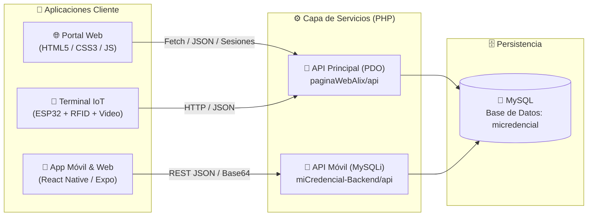

<div align="center">


# 🪪 Mi Credencial — Universidad Libre
### Sistema Integral de Carnetización Digital, Control de Acceso y Servicios Universitarios
**Seccional Cúcuta**

[](https://www.php.net/)
[](https://www.mysql.com/)
[](https://reactnative.dev/)
[](https://expo.dev/)
[](https://www.typescriptlang.org/)
[](https://www.docker.com/)
[](https://www.espressif.com/)

<p align="center">
  <a href="#-descripción-del-proyecto">Descripción</a> •
  <a href="#-características-principales">Características</a> •
  <a href="#-arquitectura-del-sistema">Arquitectura</a> •
  <a href="#-estructura-del-repositorio">Estructura</a> •
  <a href="#-roles-y-permisos">Roles</a> •
  <a href="#-instalación-y-despliegue">Instalación</a> •
  <a href="#-autores">Autores</a>
</p>

</div>

---

## 📖 Descripción del Proyecto

**Mi Credencial** es una plataforma multiplataforma (Web, Móvil e IoT) diseñada para modernizar y centralizar el sistema de identificación y control de acceso en la **Universidad Libre — Seccional Cúcuta**.

El ecosistema permite a estudiantes, docentes, administrativos, egresados no graduados y visitantes portar su credencial universitaria de manera segura, validando su identidad en tiempo real mediante **códigos QR dinámicos con expiración temporal**, tarjetas físicas **RFID/NFC** (vía terminales ESP32) y herramientas de verificación para **Portería**, **Bienestar Universitario** y **Biblioteca**.

---

## ✨ Características Principales

### 🎓 Portal Web & Carnet Digital (`paginaWebAlix`)
- **Carnet Electrónico Interactivo:** Visualización de datos institucionales, rol activo, programa académico/cargo y actualización de fotografía de perfil.
- **Código QR Dinámico Anti-Fraude:** Generación de códigos QR codificados en Base64 con marca de tiempo (`timestamp` UTC) y ventana de validez de **120 segundos** para evitar el uso de capturas de pantalla.
- **Pases Temporales para Visitantes:** Generación de boletos digitales con QR para **personas individuales** o **grupos/delegaciones** (colegios e instituciones), con vigencia configurable (30 min a 12 horas), registro de anfitrión autorizador y **exportación directa a imagen PNG**.
- **Trámites para Egresados No Graduados:** Formulario público de solicitud y renovación de credenciales sujeto a aprobación administrativa.
- **Pre-registro y Recuperación de Cuenta:** Flujo guiado de activación de cuenta institucional y cambio de contraseña.

### 🔍 Escáner Inteligente y Control de Acceso
- **Validación en Tiempo Real:** Escaneo de QR desde cámara web o dispositivo móvil para registrar entradas y salidas del campus.
- **Integración con Bienestar Universitario y Biblioteca:** Al escanear el carnet de un estudiante, el sistema consulta automáticamente si posee préstamos activos, vencidos o sanciones en **Bienestar Universitario** (implementos deportivos, equipos) y **Biblioteca** (libros, multas).
- **Bitácora e Historial de Accesos:** Consulta detallada de movimientos filtrables por fecha, usuario y tipo de acceso.

### 🛠️ Panel de Administración
- **Gestión de Usuarios y Roles:** Asignación de roles y control de estado de cuentas (`activo` / `inactivo`).
- **Carga Masiva por CSV:** Importación rápida de listados de usuarios y estudiantes mediante archivos `.csv`.
- **Bandeja de Solicitudes:** Aprobación o rechazo de solicitudes de egresados no graduados.

### 📱 Aplicación Móvil y Web Multiplataforma (`miCredencial-WebPage`)
- Desarrollada con **React Native**, **Expo Router** y **TypeScript**.
- **Carnet Digital Móvil:** Sincronización de foto desde la cámara del dispositivo (`expo-image-picker`) hacia el backend y visualización de QR dinámico.
- **Módulo de Bienestar Universitario:** Catálogo de préstamos (raquetas, computadores, balones), agendamiento de citas médicas y cursos.
- **Herramientas de Gestión Móvil:** Accesos rápidos para administración y generación de pases temporales QR.
- **Mapa Interactivo del Campus:** Vista previa de ubicación con `react-native-maps`.

---

## 🏗️ Arquitectura del Sistema



---

## 📂 Estructura del Repositorio

```text
MiCredencial/
├── 📁 paginaWebAlix/              # Aplicación Web Principal y API Backend (PHP + PDO)
│   ├── 📁 admin/                  # Vistas del Panel de Administración (CSV, usuarios, carnets, egresados)
│   ├── 📁 api/                    # Endpoints del servidor organizados por módulo
│   │   ├── 📁 admin/              # Gestión de roles, usuarios, importación CSV y sesiones
│   │   ├── 📁 auth/               # Login, registro y cierre de sesión
│   │   ├── 📁 carnet/             # Obtención de carnet, subida de foto y pases temporales
│   │   ├── 📁 egresados/          # Recepción de solicitudes de egresados no graduados
│   │   ├── 📁 escaner/            # Procesamiento de QR, validación y registro de accesos
│   │   └── 📄 conexion.php        # Conexión PDO a MySQL y motor de herencia de roles
│   ├── 📁 css/                    # Hojas de estilo (carnet, escáner, admin, UI)
│   ├── 📁 html/                   # Vistas de usuario (login, carnet, escáner, historial, preregistro)
│   ├── 📁 IMG/                    # Recursos gráficos institucionales
│   └── 📁 js/                     # Lógica cliente (generación QR, cámara, exportación PNG, admin)
│
├── 📁 miCredencial-WebPage/       # App Móvil / Web Universal (Expo SDK 54 + React Native + TS)
│   ├── 📁 app/                    # Rutas basadas en archivos (expo-router)
│   │   ├── 📁 (login)/            # Pantallas de inicio de sesión, registro y renovación
│   │   ├── 📁 (tabs)/             # Navegación principal (Home, Bienestar, Herramientas, About)
│   │   └── 📁 carnetTemporal/     # Flujo de creación de carnets temporales en móvil
│   ├── 📁 components/             # Componentes reutilizables (Carnet, QR, Mapa, Header, TabBar)
│   ├── 📁 constants/              # Estilos, íconos y temas visuales
│   ├── 📄 Dockerfile              # Build multi-etapa con Node 20 + Nginx para despliegue web
│   └── 📄 docker-compose.yml      # Orquestación de contenedor en puerto 3000
│
├── 📁 miCredencial-Backend/       # API REST ligera para la App Móvil (PHP + MySQLi)
│   ├── 📁 api/                    # Endpoints JSON (login.php, uploadPhoto.php, usuarios.php)
│   └── 📁 config/                 # Configuración de conexión a base de datos (db.php)
│
└── 📁 lib/                        # Librerías de soporte para hardware (ESP32CompositeVideo)
```

---

## 🔐 Roles y Permisos

El sistema implementa un motor centralizado de **herencia de roles** (`obtenerRolesUsuario` en `paginaWebAlix/api/conexion.php`), otorgando capacidades operativas automáticamente según el perfil del usuario:

| Rol Principal | Carnet Digital | Generar Pase Temporal | Escáner Portería | Escáner Bienestar / Biblioteca | Panel Admin Total |
| :--- | :---: | :---: | :---: | :---: | :---: |
| **Estudiante / Egresado NG** | ✅ | ❌ | ❌ | ❌ | ❌ |
| **Docente** | ✅ | ✅ | ❌ | ❌ | ❌ |
| **Administrativo** | ✅ | ✅ | ❌ | ❌ | ❌ |
| **Seguridad** | ✅ | ✅ | ✅ | ❌ | ❌ |
| **Bienestar / Biblioteca** | ✅ | ❌ | ❌ | ✅ | ❌ |
| **Administrador** | ✅ | ✅ | ✅ | ✅ | ✅ |

---

## 🚀 Instalación y Despliegue

### Prerrequisitos
- **XAMPP** (Apache + PHP 8.x + MySQL / MariaDB)
- **Node.js** v18 o v20+ y `npm`
- **Expo Go** (en dispositivo físico) o Android Studio / Emulador (para la app móvil)
- **Docker** *(opcional, para desplegar la versión web de Expo)*

---

### 1️⃣ Configuración de la Base de Datos y Backend PHP

1. Clona este repositorio dentro de la carpeta `htdocs` de tu instalación de XAMPP:
   ```bash
   cd C:/xampp/htdocs
   git clone https://github.com/CristianSoryu/MiCredencial.git
   ```
2. Inicia los módulos **Apache** y **MySQL** desde el panel de control de XAMPP.
3. Crea una base de datos llamada `micredencial` en **phpMyAdmin** (`http://localhost/phpmyadmin`) con cotejamiento `utf8mb4_general_ci` e importa las tablas del sistema (`usuarios`, `roles`, `usuario_rol`, `carnets_temporales`, `preregistro_oficial`, `solicitudes_egresados_no_graduados`, `historial_accesos`).
4. Verifica las credenciales de conexión por defecto (`host: localhost`, `user: root`, `password: ""`, `db: micredencial`, `port: 3306`) en:
   - `paginaWebAlix/api/conexion.php`
   - `miCredencial-Backend/config/db.php`
5. Accede al portal web desde tu navegador:
   ```text
   http://localhost/MiCredencial/paginaWebAlix/
   ```

---

### 2️⃣ Ejecución de la Aplicación Móvil (`miCredencial-WebPage`)

1. Ingresa al directorio de la aplicación Expo e instala las dependencias:
   ```bash
   cd miCredencial-WebPage
   npm install
   ```
2. Inicia el servidor de desarrollo de Expo:
   ```bash
   npx expo start
   ```
3. Opciones de ejecución:
   - Presiona **`a`** para abrir en un emulador de Android.
   - Presiona **`w`** para abrir en el navegador web.
   - Escanea el código QR con la app **Expo Go** en tu teléfono (asegúrate de actualizar la IP local del servidor en los endpoints de `app/(login)/index.tsx` y `components/carnet.tsx`).

---

### 3️⃣ Despliegue con Docker (App Web Expo)

El proyecto incluye soporte para contenedores en `miCredencial-WebPage`:

```bash
cd miCredencial-WebPage
docker compose up -d --build
```
La aplicación quedará disponible en `http://localhost:3000`.

---

## 👥 Autores

Proyecto desarrollado para la **Universidad Libre — Seccional Cúcuta** por:

- **Cristian Torres** — [@CristianSoryu](https://github.com/CristianSoryu)
- **Juan Ruiz**
- **Alejandro Urbina**

---

<div align="center">
  <sub>© 2026 Universidad Libre — Seccional Cúcuta. Todos los derechos reservados.</sub>
</div>
